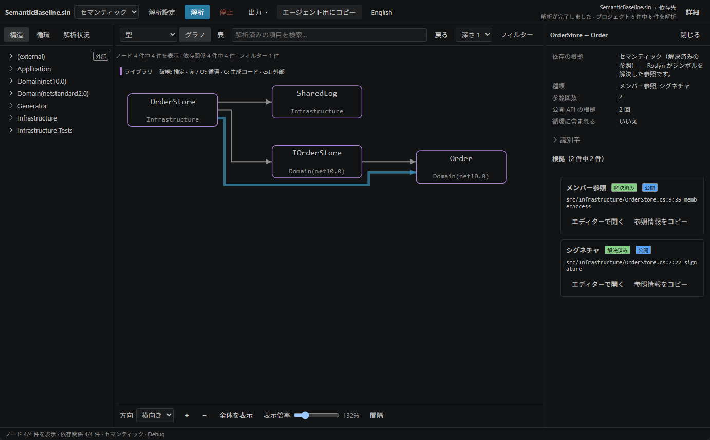

# SharpDeps

[English](README.md) · [MCP サーバー（NuGet）](https://www.nuget.org/packages/SharpDeps.Mcp) · [VS Code 拡張機能](https://marketplace.visualstudio.com/items?itemName=htkym.sharpdeps)

SharpDeps は C# のコード検索と依存関係の調査に使えるローカルの MCP（Model Context Protocol）サーバーです。AI アシスタントは .NET のプロジェクトをまたいでメソッドの呼び出し元や呼び出し先をたどり、該当するファイルと行番号を回答に添えられます。VS Code 拡張機能では、プロジェクト間の参照から個々の型の依存関係まで、マップを見ながら調べられます。

## AI アシスタントにコードについて質問する

メソッドを変更する前に、たとえばこんな質問ができます。

> SharpDeps で `OrderStore.Save` を調べてください。このメソッドは何を呼び出していますか。呼び出し箇所のファイル名と行番号を示して、呼び出し先のメソッドの宣言も見せてください。

メソッド名は自分のプロジェクトにあるものに置き換えてください。この例なら、AI アシスタントは MCP の `explore` に `{"query":"OrderStore.Save","responseMode":"detail"}` を渡して検索できます。回答に示されたファイルの該当行を開くと、呼び出し箇所を確認できます。`Resolved` と表示されるのは、そのビルド構成でコンパイラーが呼び出し先を特定できた場合です。実行時には別の実装が呼ばれることもあります。

### MCP サーバーを接続する

Codex、Claude Code、GitHub Copilot など、MCP に対応した AI アシスタントから利用できます。サーバーの実行には .NET 10 ランタイムが必要です。対象のソリューションに対応する .NET SDK を用意してください。次のコマンドはソリューションのフォルダーで実行します。`Shop.sln` は実際のファイル名に置き換えてください。

```sh
dotnet tool install --global SharpDeps.Mcp
dotnet restore Shop.sln
```

AI アシスタントの MCP 設定に `sharpdeps-mcp` を標準入出力（stdio）で接続するサーバーとして追加します。`mcpServers` を使うクライアントの設定例です。

```json
{
  "mcpServers": {
    "sharpdeps": {
      "command": "sharpdeps-mcp",
      "args": ["--root", "/absolute/path/to/Shop", "--trusted", "--allow-mutations"]
    }
  }
}
```

パスにはソリューションのフォルダーを絶対パスで指定してください。この設定は信頼できるワークスペースで使います。`--trusted` を指定すると、AI アシスタントがサーバーを通じてソースを読めます。`--allow-mutations` を加えると索引の作成と更新もできます。その際、プロジェクトのビルド処理やソースジェネレーターが動くことがあります。

接続し直したら「SharpDeps で `Shop.sln` の Release 構成の索引を作ってください」と頼みます。索引ができたら、コードについて質問できます。`index` に `projects` という項目があれば、大きなソリューションでも調べたいプロジェクトに範囲を絞れます。呼び出しをたどるときは、呼び出し元と呼び出し先の両方の `.csproj` を指定してください。コードを編集した後は、同じプロジェクトと構成で索引の更新を頼みます。

自分で索引を作る場合は CLI を使い、MCP の設定から `--allow-mutations` を外してください。AI アシスタントは作成済みの索引を読み取り専用で使えます。[SharpDeps CLI（NuGet）](https://www.nuget.org/packages/SharpDeps.Cli) · [CLI と MCP の使い方](docs/mcp.md)

結果が `Partial` の場合、見つからなかった呼び出しが解析範囲の外にある可能性があります。鮮度が `unverified` のときは、解析に使ったすべての入力が索引作成時と一致するかを確認できていません。ワークスペース内のファイルからソースを表示するときは、その内容を索引作成時のハッシュと照合します。

## VS Code で依存関係をたどる

VS Code 1.90 以降で [SharpDeps 拡張機能](https://marketplace.visualstudio.com/items?itemName=htkym.sharpdeps)をインストールします。拡張機能は単独でも使えます。

1. 信頼できるソリューションのフォルダーを開きます。エクスプローラーで `.sln`、`.slnx` または `.csproj` ファイルを右クリックし、「SharpDeps: Show Dependency Map」を選びます。
2. プロジェクト参照を見渡すには「クイック」を使います。C# の呼び出しや型の参照を調べるには、パッケージを復元してから「セマンティック」を選び、「解析」を押します。
3. マップの接続線を選びます。「詳細」に出た参照の横にある「エディターで開く」を押すと、該当するソース行に移動します。



画面で調べた内容は「エージェント用にコピー」でクリップボードにコピーし、AI アシスタントに渡せます。クイックで使う .NET 10 ランタイムは必要に応じて拡張機能が取得します。セマンティックではソリューションに対応する SDK と復元済みの依存パッケージも必要です。[VS Code 操作ガイド](docs/guide.ja.md)

[MIT ライセンス](LICENSE) · [サードパーティーのライセンス](THIRD-PARTY-NOTICES.md)
