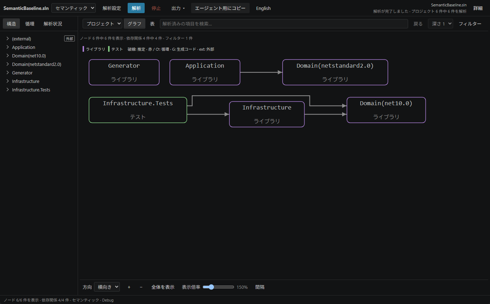

# SharpDeps — .NET 依存関係マップ

[English](README.md) · 日本語 · [VS Code 操作ガイド](docs/guide.ja.md) · [CLI／MCP](docs/mcp.md)

SharpDeps は .NET のプロジェクト・名前空間・型の依存関係を VS Code で表示し、収集した関係のソース位置を確認できる拡張機能です。別途提供する CLI では索引を保存して繰り返し検索でき、MCP サーバーを接続すると AI クライアントからその索引を調べられます。



画像は 0.1.0 の画面です。現在の操作と保存索引の互換性は、各ガイドで説明しています。

## AI 調査の測定結果と限界

通常はシンボル検索・正確な定義取得・1 段の関係取得を使います。提出前に、既にある証拠と回答を照合し、分岐条件や例外・後始末の経路を確認します。追加取得は不足する証拠だけに限定します。`explore` は明示的な依頼や手動調査用として残し、自動では切り替えません。

別に行った**過去の制御比較**では、typed-only の SharpDeps は、SharpDeps なしのソース探索に対し、**総ホストトークンを 43.4% 削減**し、**有効回答 1 件あたりのホスト推定費用を 34.3% 削減**しました。選定した多段課題 2 問 × 各条件 2 回で、品質は 11.50／12 対 11.25／12、重大誤りは 0 件でした。検証用に変更した環境での少数例であり、**現行製品の保証や、提出前確認・F4 チェックリストの改善効果を示すものではありません**。[条件・数値の根拠・計算式](docs/multihop-comparison-results.md)。

2026 年 11 月 18 日の診断では、typed／ソースによる必須再確認と explore による必須再確認を、2 課題・各条件 2 回で比較しました。最終品質は **EF Core で両条件 11／12、Orleans で両条件 12／12**、重大誤りは 0 件でした。8 回答中 5 回答は仮回答から改善しましたが、**再確認なしの対照条件がないため、確認を必須にする効果は未検証**です。EF の release 失敗のログと finally の後始末例外による置換は、どちらの方法でも書き落とされました。

Orleans では検証用の契約を変更しているため、課題ごとに別集計としています。費用の傾向も課題で異なり、この少数例から効率の優劣や品質の同等性は主張できません。[測定の詳細と限界](docs/forced-verification-results.md)。

## インストール

[Visual Studio Marketplace](https://marketplace.visualstudio.com/items?itemName=htkym.sharpdeps) から **SharpDeps — .NET Dependency Map** をインストールします。[GitHub Releases](https://github.com/Htkym/sharpdeps/releases) の VSIX を使う場合は、VS Code の **Extensions: Install from VSIX…** で選択してください。この文書は 0.5.0 を対象としています。インストール前に Marketplace またはリリースページで公開状況を確認してください。

VS Code 1.90 以降が必要です。解析を実行する前に、ワークスペースを信頼済みにしてください。

| モード         | 調べる内容                                               | 必要な環境                                                          |
| -------------- | -------------------------------------------------------- | ------------------------------------------------------------------- |
| クイック       | プロジェクト参照、C# の宣言、構文に基づく関係。          | .NET 10 ランタイム。SDK、MSBuild の評価、パッケージ復元は不要です。 |
| セマンティック | 評価済みの C# 参照、シンボル解決済みの関係とソース位置。 | .NET 10 ランタイム、対象に対応する SDK、復元済みの対象パッケージ。  |

拡張機能のランタイムは必要に応じて [.NET Install Tool](https://marketplace.visualstudio.com/items?itemName=ms-dotnettools.vscode-dotnet-runtime) から取得します。SharpDeps が SDK をインストールしたり、対象パッケージを自動で復元したりすることはありません。

拡張機能には解析プログラムと保存索引の reader を同梱しています。CLI だけを更新しても、同梱プログラムは更新されません。0.5.0 の reader は索引の schema 1／2／3 に対応します。別のバージョンで作った索引を使う際は、[保存索引の設定](docs/guide.ja.md#保存済み索引を使う)を確認してください。

## マップを開く

1. ソリューションのフォルダーを VS Code で開きます。
2. エクスプローラーで `.sln`、`.slnx`、または対応するプロジェクトファイルを右クリックし、**SharpDeps: Show Dependency Map** を選びます。
3. ノードや接続線を選ぶと、**詳細**で根拠を確認できます。**依存先**や**依存元**で範囲を絞れます。

クイックは `.csproj`、`.fsproj`、`.vbproj`、`.vcxproj` に対応し、セマンティックは SDK スタイルの C# プロジェクトを対象にします。プロジェクトを選ぶと参照先をたどって解析します。シンボル解決済みの結果を調べる場合は、**セマンティック**を選んで**解析**を押してください。

検索、フィルター、グラフ、表は同じ表示範囲を使います。表示件数の上限は描画にだけ適用され、解析データや循環依存の検出を制限しません。Quick／Semantic の表示は Mermaid、JSON、SVG、PNG 形式で、保存索引の表示は JSON 形式で出力できます。**エージェント用にコピー**はクリップボードへのコピーであり、AI サービスへ送信する操作ではありません。

解析と描画はローカルで実行します。解析が失敗または中断した場合は、直前の成功した表示を残します。関係が見つからない場合や推定の関係を判断する際は、解析範囲、確度、制限事項も確認してください。設定、ソースへの移動、問題への対処は [VS Code 操作ガイド](docs/guide.ja.md)で説明しています。

## CLI と MCP

[CLI ツール](https://www.nuget.org/packages/SharpDeps.Cli)と、必要に応じて [MCP サーバー](https://www.nuget.org/packages/SharpDeps.Mcp)をインストールします。

```bash
dotnet tool install --global SharpDeps.Cli --version 0.5.0
dotnet tool install --global SharpDeps.Mcp --version 0.5.0
```

ツールのインストールには SDK、インストール済みツールの実行には .NET 10 ランタイムが必要です。索引の作成には対象に対応する SDK と復元済みの依存関係も必要です。公開済み 0.4.0 の CLI／MCP は Markdown の解析に Syntamark 1.2.0 を使い、0.5.0 のツールは 2.0.0 を使います。どちらのパーサーも VSIX には同梱しません。

[CLI／MCP ガイド](docs/mcp.md)では索引の作成、ソース検索、MCP 接続、範囲の選択、信頼、有限の時間予算とエラーへの対処を説明しています。更新手順は [0.4.0 からの移行](docs/mcp.md#upgrade-from-040)を参照してください。以前のバージョンに対応する説明は [0.4.0 のガイド](https://github.com/Htkym/sharpdeps/blob/v0.4.0/docs/mcp.md)を参照してください。

AI クライアントで使う場合は、[導入とオプトアウト](docs/mcp.md#agent-routing-and-opt-out)を確認してください。索引に含まれる構造の情報が必要なときに、SharpDeps を使えます。利用は必須ではなく、対象の場所が分かっていれば通常の検索や読取りも選べます。取得済みの根拠を再利用し、必要な根拠がそろったら探索を終えます。事前に情報を渡す prompt-context フックは実験的な機能で、明示的に有効にした場合だけ使います。後続の取得と情報が重複し、トークン使用量が増える場合があります。これはモデル向けの案内であり、ホストによるツールの実行順序の強制ではありません。接続だけでソースの読取りや索引更新が許可されるわけではありません。Partial coverage や鮮度未検証の状態はそのまま示します。取得回数やトークン使用量の削減、すべての操作が 1 秒以内に終わることは保証しません。

## ライセンス

[MIT](LICENSE)。同梱コンポーネントについては[ライセンス情報](THIRD-PARTY-NOTICES.md)を参照してください。
