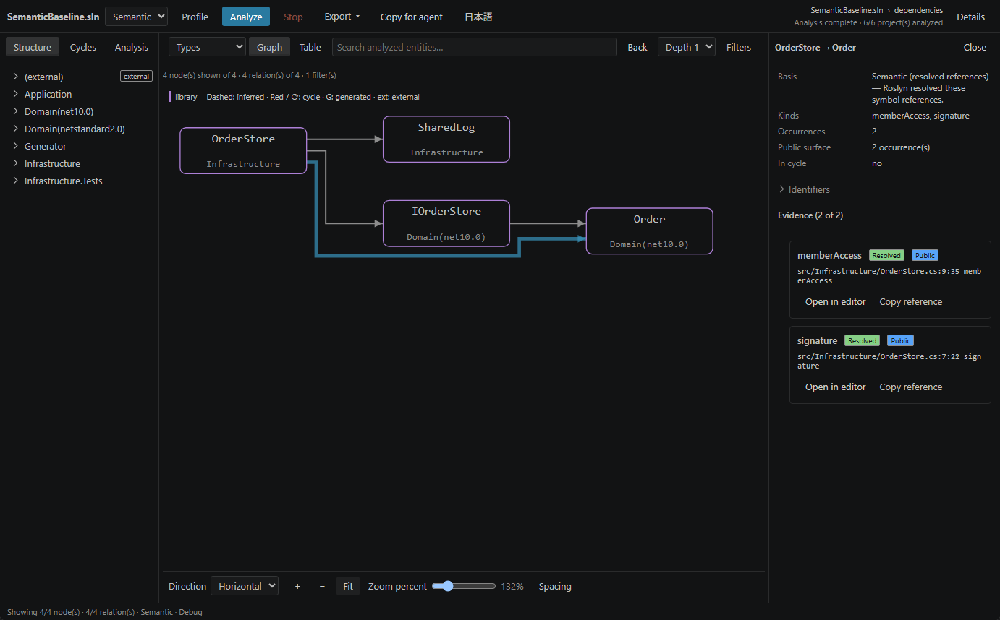

# SharpDeps

[日本語](README.ja.md) · [MCP server on NuGet](https://www.nuget.org/packages/SharpDeps.Mcp) · [VS Code extension](https://marketplace.visualstudio.com/items?itemName=htkym.sharpdeps)

SharpDeps is a local Model Context Protocol (MCP) server for C# code search and dependency analysis. An AI coding assistant can trace calls across .NET projects and show you the files and lines where one method calls another. The VS Code extension lets you explore the same code visually, from project references down to individual types.

## Ask an AI assistant about your code

Before changing a method, try a question like this.

> Use SharpDeps to find `OrderStore.Save`. What does it call? Show me the file and line for each call you find, and open the declaration of the method it calls.

Use a method name from your own solution. For the example above, the assistant can call the MCP tool `explore` with `{"query":"OrderStore.Save","responseMode":"detail"}`. Follow the returned file and line to check the call. A call marked `Resolved` identifies the target the compiler found for that build configuration. Runtime dispatch can select a different implementation.

### Connect the MCP server

You can use the MCP server directly from an assistant such as Codex, Claude Code or GitHub Copilot. You need the .NET 10 runtime to run the server and a .NET SDK to install it. To index a solution, use an SDK compatible with that solution and restore its dependencies. Run these commands in the solution directory, replacing `Shop.sln` with your solution's filename.

```sh
dotnet tool install --global SharpDeps.Mcp
dotnet restore Shop.sln
```

Add `sharpdeps-mcp` as a stdio server in your assistant's MCP settings. The example below is for clients that use `mcpServers`.

```json
{
  "mcpServers": {
    "sharpdeps": {
      "command": "sharpdeps-mcp",
      "args": ["--root", "/absolute/path/to/Shop", "--trusted", "--allow-mutations"]
    }
  }
}
```

Replace the example path with the absolute path to your solution directory. Use these settings for a workspace you trust. `--trusted` allows the assistant to read source through the server. `--allow-mutations` also lets it create and update the index, which can run the project's build logic and source generators.

Reconnect the client and ask it to index `Shop.sln` in Release with SharpDeps. Once indexing finishes, ask your question about the code. On a large solution, if the `index` tool offers a `projects` field, select the `.csproj` files for both the caller and the callee. After editing the code, ask the assistant to update the index with the same selection and configuration.

If you prefer to create the index yourself, use the CLI and omit `--allow-mutations` from the MCP settings. Your assistant can then query the saved index in read-only mode. [SharpDeps CLI on NuGet](https://www.nuget.org/packages/SharpDeps.Cli) · [CLI and MCP guide](docs/mcp.md)

`Partial` means that a missing call may be outside the indexed scope. With `unverified` freshness, SharpDeps could not confirm that all inputs still match the index. Before quoting a workspace file, the server checks its contents against the saved hash.

## Explore the dependency map in VS Code

Install [SharpDeps from the Visual Studio Marketplace](https://marketplace.visualstudio.com/items?itemName=htkym.sharpdeps) in VS Code 1.90 or later. The extension works independently of the MCP server.

1. Open a solution folder you trust. In Explorer, right-click a `.sln`, `.slnx` or `.csproj` file and choose **SharpDeps: Show Dependency Map**.
2. Use **Quick** for an overview of project references. To inspect C# calls and type references, restore the solution, select **Semantic**, then choose **Analyze**.
3. Select a connection on the map. In **Details**, choose **Open in editor** beside a reference to jump to the source line.



Use **Copy for agent** to put the selected context on the clipboard when you want to discuss it with your assistant. Quick mode needs the .NET 10 runtime, which the extension can obtain for you. Semantic mode also needs the solution's SDK and restored dependencies. [VS Code guide](docs/guide.md)

[MIT license](LICENSE) · [Third-party notices](THIRD-PARTY-NOTICES.md)
