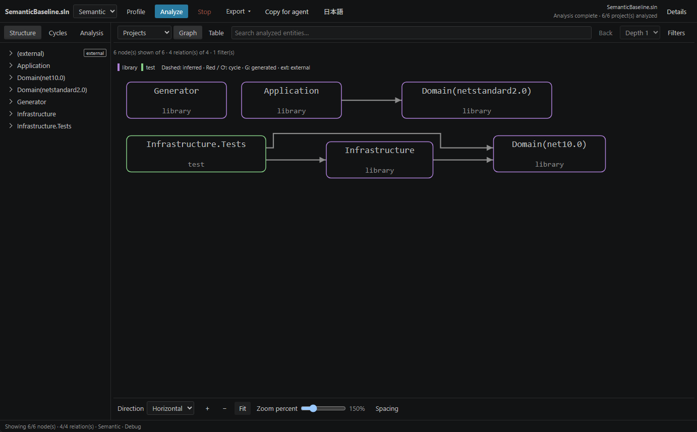

# SharpDeps — .NET Dependency Map

English · [日本語](README.ja.md) · [VS Code guide](docs/guide.md) · [CLI and MCP](docs/mcp.md)

SharpDeps shows .NET project, namespace and type dependencies in VS Code, with source locations for the relationships it collected. The separate CLI saves an index for repeatable queries; the optional MCP server lets an AI client explore that index.



The images show the 0.1.0 workbench. See the guides for current controls and saved-index compatibility.

## Install

Install **SharpDeps — .NET Dependency Map** from the [Visual Studio Marketplace](https://marketplace.visualstudio.com/items?itemName=htkym.sharpdeps), or download the VSIX from [GitHub Releases](https://github.com/Htkym/sharpdeps/releases) and choose **Extensions: Install from VSIX…** in VS Code. Version 0.4.0 is the latest released version.

VS Code 1.90 or later is required. Trust the workspace before running analysis.

| Mode | Use it for | Requirements |
| --- | --- | --- |
| Quick | Project references, C# declarations and syntax-based relationships. | .NET 10 runtime; no SDK, MSBuild evaluation or package restore. |
| Semantic | Evaluated C# references, symbol-resolved relationships and source evidence. | .NET 10 runtime, a target-compatible SDK and restored target dependencies. |

The [.NET Install Tool](https://marketplace.visualstudio.com/items?itemName=ms-dotnettools.vscode-dotnet-runtime) supplies the extension's runtime when needed. SharpDeps does not install an SDK or restore your project's packages.

The extension bundles its own analysis and saved-index reader hosts. Installing a newer CLI does not update those hosts. The 0.4.0 reader supports index schemas 1/2/3; see [saved-index setup](docs/guide.md#read-a-saved-index) before using an index from another tool version.

## Open a map

1. Open your solution folder in VS Code.
2. Right-click a `.sln`, `.slnx` or supported project file and choose **SharpDeps: Show Dependency Map**.
3. Select a node or connection to inspect **Details**. Use **Dependencies** or **Dependents** to narrow the view.

Quick accepts `.csproj`, `.fsproj`, `.vbproj` and `.vcxproj`; Semantic targets SDK-style C# projects. A project target includes its transitive project references. Choose **Semantic** and **Analyze** for symbol-resolved results.

Search, filters, the graph and the table share the current scope. Display limits restrict the picture, not the analyzed data or cycle detection. Quick/Semantic views export Mermaid, JSON, SVG or PNG; the saved-index view exports JSON. **Copy for agent** writes context to the clipboard and does not send it to an AI service.

Analysis and rendering run locally. A failed or cancelled analysis retains the last successful view. Read coverage, certainty and limitations before interpreting a missing or inferred relationship. See the [VS Code guide](docs/guide.md) for settings, source navigation and troubleshooting.

## CLI and MCP

Install the separate [.NET CLI tool](https://www.nuget.org/packages/SharpDeps.Cli) and, when needed, the [MCP server](https://www.nuget.org/packages/SharpDeps.Mcp):

```bash
dotnet tool install --global SharpDeps.Cli --version 0.4.0
dotnet tool install --global SharpDeps.Mcp --version 0.4.0
```

Tool installation requires an SDK; running an installed tool requires the .NET 10 runtime. Indexing additionally requires the target's SDK and restored dependencies. The CLI/MCP tools use Syntamark 1.2.0 for Markdown; that parser is not bundled in the VSIX.

The [CLI/MCP guide](docs/mcp.md) covers indexing, source queries, normal MCP connection, scope selection, trust, finite time budgets and recovery. It marks unreleased additions separately from published 0.4.0 behavior. For the released implementation, use the [0.4.0 guide](https://github.com/Htkym/sharpdeps/blob/v0.4.0/docs/mcp.md).

For AI clients, follow [agent setup and opt-out](docs/mcp.md#agent-routing-and-opt-out). Use indexed tools for structural questions and ordinary search for simple text or unindexed work. A connection does not grant source access or permission to update an index. Partial coverage and unverified freshness remain visible; fewer reads, lower token use and universal one-second completion are not guaranteed.

## License

[MIT](LICENSE). See [third-party notices](THIRD-PARTY-NOTICES.md) for bundled components.
