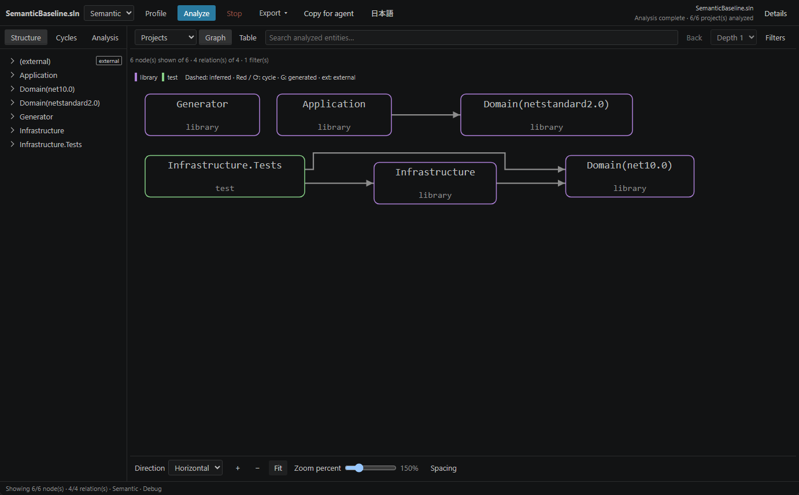
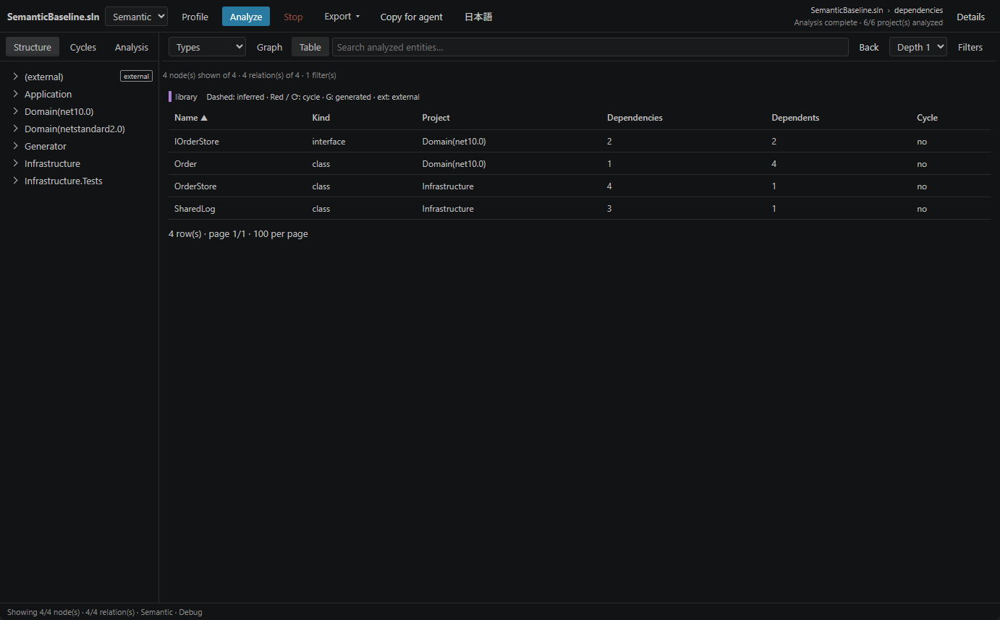
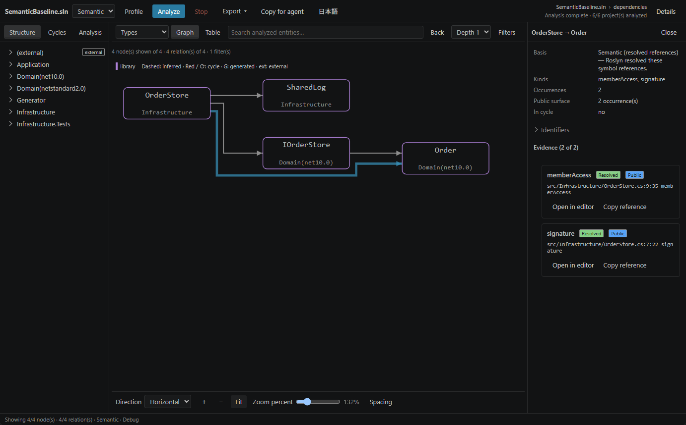
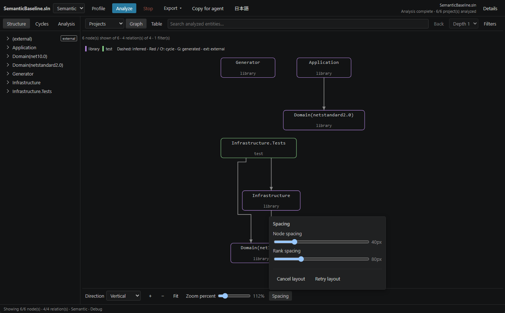

# SharpDeps user guide

English · [日本語](guide.ja.md) · [README](../README.md)

Install the extension from the [Visual Studio Marketplace](https://marketplace.visualstudio.com/items?itemName=htkym.sharpdeps) or select a downloaded VSIX with **Extensions: Install from VSIX…**. The latest released version is 0.4.0. Quick does not require a separate CLI installation. Features marked **Unreleased** describe this source tree; use the [tagged 0.4.0 guide](https://github.com/Htkym/sharpdeps/blob/v0.4.0/docs/guide.md) for that release.

The screenshots show the 0.1.0 workbench with external types hidden. They illustrate navigation and graph controls; saved-index compatibility depends on the installed reader version.

## Open a solution or project

1. Open the target folder in VS Code and trust the workspace if you intend to run analysis.
2. In Explorer, right-click a `.sln`, `.slnx`, or project file and choose **SharpDeps: Show Dependency Map**. Quick accepts `.csproj`, `.fsproj`, `.vbproj`, and `.vcxproj`; Semantic is intended for SDK-style C# projects.
3. Wait for analysis to finish. The target and status appear at the top; the node and connection counts describe the current display.

From the Command Palette, the same command uses a supported file in the active editor, or discovers solutions in the workspace. If several candidates are found, select the target you want. A project-file target includes its transitive project references.



In this example, `Infrastructure` depends on `Domain(net10.0)`. `Domain(netstandard2.0)` is a separate target-framework variant; matching names do not mean the two results are merged.

## Choose an analysis mode

Use **Quick** to inspect projects, namespaces, and C# type declarations. It reads project XML and C# syntax without MSBuild evaluation or symbol binding, so conditional references and unused imports may appear. Where a base-list name has one matching declaration, such as within the same project and namespace, it can appear as a syntax type reference. This does not prove callers or resolved inheritance. Quick needs a .NET 10 runtime; it does not require an SDK or package restore. Runtime resolution tries `sharpdeps.dotnetPath`, the .NET Install Tool, `PATH`, then private runtime acquisition.

Use **Semantic** to investigate C# callers and resolved code references:

1. Install an SDK compatible with the target and its `global.json`, and make a .NET 10 runtime available.
2. Restore the target's packages yourself, for example with `dotnet restore path/to/YourSolution.sln` in a terminal.
3. Select **Semantic** at the top. If needed, use **Profile** to set Configuration and Platform.
4. Choose **Analyze**. After loading, the **Analysis** tab offers per-project target-framework choices. **Automatic** keeps evaluated variants separate. Changing a framework or profile requires another analysis; conflicting framework choices are reported as errors.

SharpDeps does not download an SDK or restore packages automatically. It requires workspace trust because Semantic evaluates project build logic and source generators. Quick provides inferred relationships; Semantic may still report incomplete results when projects or references cannot be loaded. Read the Analysis tab's coverage and limitations before drawing conclusions.

## Inspect types and source with Quick

`sharpdeps.resultProvider` defaults to `legacy`, and `sharpdeps.analysisMode` to `quick`. If you previously selected the saved-index provider, choose `legacy` for this first Quick journey.

1. Open a trusted target and choose **SharpDeps: Show Dependency Map** to display its Quick result.
2. Switch to **Types** and search for a type name. In **Table**, selecting a row opens Details. With the keyboard, use Tab to reach a row and Space to select it; Enter activates the item.
3. Choose **Open declaration** to open the original code. For example, `class Base { }` and `class Derived : Base { }` in the same C# project provide declarations and an entry point into the syntax reference from `Derived` to `Base`. Relation evidence also points to syntax locations. Do not treat ambiguous references or results without locations as resolved references.
4. Use VS Code's tab switching to return to the dependency map. In a narrow view, **Close** or Escape dismisses Details before you use **Back**. Use Tab to reach Back and Enter to activate it. Check the search, selection, and view position. Opening source alone does not require going back through scopes.

If a type is missing, check the target, search conditions, and Analysis limitations. Quick does not resolve every type reference. Use Semantic for method callers, or savedIndex below for stored member/document graphs.

## Read a saved index

Set `sharpdeps.resultProvider` to `savedIndex` to read the workspace's `.sharpdeps/index.sqlite` with the bundled QueryHost. The extension currently uses that default path; it has no custom index-path setting. This is separate from choosing Quick or Semantic. Reading requires an existing .NET 10 runtime; this path does not acquire one automatically. With multiple variants, set `sharpdeps.savedIndexVariant` to the exact `hvar_` ID to display. A blank value selects a variant only when exactly one exists; variants are never merged implicitly.

The 0.4.0 VSIX bundles a reader for SQLite index schemas 1/2/3. The published 0.2.1 extension reads only schema 1. Upgrading the NuGet CLI or changing `sharpdeps.savedIndexCliPath` does not replace the extension's bundled reader: update the VSIX as well before using schema-2/3 indexes. The 0.4.0 tools create schema-3 indexes and do not convert old indexes in place. See [CLI/MCP upgrade instructions](mcp.md#upgrade-from-030) for compatibility and offline backup requirements. Their separate-path examples are for CLI/MCP; to try a new default index in VS Code while preserving an older workspace and index, use a separate source checkout and create its default index.

**Refresh** rereads stored results. To create or update an index, set `sharpdeps.savedIndexCliPath` to the absolute path of a compatible `SharpDeps.Cli.dll`, then explicitly run **SharpDeps: Update Saved Index** in a trusted workspace. This external CLI supplies explicit writes and owner-status observation; the bundled QueryHost still supplies reads. Updating requires the target SDK and restored dependencies. Running the CLI DLL directly and querying stored results require a .NET 10 runtime; local tool installation/restore, `dotnet tool run`, and `dnx` require an SDK. See the [CLI/MCP guide](mcp.md) for supported capabilities and the [CLI contract](https://github.com/Htkym/sharpdeps/blob/main/docs/contracts/cli-skill-v1.ja.md) for trust and source requirements.

`sharpdeps.savedIndexAutoRefresh` defaults to `false`. To enable it, use savedIndex in one trusted workspace folder, configure the same compatible CLI, and explicitly start its watch with a chosen target. Replace the paths in this PowerShell example with your prepared paths. This starts analysis and index writes.

```powershell
dotnet 'D:\tools\SharpDeps.Cli.dll' serve --root 'D:\work\repo' --target 'D:\work\repo\App.sln' --trusted --watch
```

The extension adopts committed generations from the existing owner; it does not start watch or analysis. If watch stops or reading fails, it retains the last view as stale. Unsaved edits are not indexed. `Partial` means coverage is incomplete; `unverified` means correspondence with current inputs and configuration has not been verified. Automatic adoption or a running owner does not turn those states into `Complete` or a freshness guarantee. See [watch scope and limitations](https://github.com/Htkym/sharpdeps/blob/main/docs/contracts/saved-input-watch-v1.ja.md).

## Find and narrow dependencies

Choose **Projects**, **Namespaces**, or **Types** above the graph. Quick shows syntax-based type results; Semantic shows semantic analysis results. Expand the left-hand hierarchy with its chevrons, or use search to find an entity across the full analyzed index, including entities outside the display limit.

Select a node to open **Details**. Choose **Dependencies** to follow its outgoing references, or **Dependents** to find what refers to it. **Depth 1–3** controls how many steps to follow. Double-click a project or namespace to drill down; **Back** returns to the preceding scope. If a search term still restricts the graph, clear it to see the other entities in the chosen scope.

Open **Filters** to include project kinds, type kinds, relation kinds and basis, tests, external types, and generated types. A category with no checked choices includes all its values. Close the panel with Escape or an outside click. Filtering changes the view without rerunning analysis.

Switch to **Table** for a sortable list of the same scope. Select a row to inspect that entity, then return to **Graph** to see its connections.



## Read connections and evidence

An arrow points from the dependent entity to the entity it depends on. Node colors identify project kinds, with a legend above the graph.

| Appearance | Meaning |
| --- | --- |
| Solid line | At least one included relation is declared, evaluated, or symbol-resolved. In Quick, a declared project reference does not prove that the compiled code uses it. |
| Dashed line | Only inferred relationships exist, such as a namespace dependency suggested by `using`. |
| Red line or cycle mark | The connection or entity belongs to a detected cycle group. |
| `G` / `ext` | Generated code / an external type. These marks are separate from the relation's basis. |

A directed node pair has one visible connection. When several relations contribute to it, Details retains their separate basis and occurrence counts. Selecting an underlying relation keeps its own evidence selected and highlights the shared connection.

To inspect a source reference:

1. Select a connection in the graph. **Details** shows the basis, relation kinds, counts, and source evidence.
2. If the connection aggregates several relations, choose **Evidence** for the underlying relation you want. The initial evidence list belongs to the representative relation.
3. Choose **Open in editor** beside a reference. Generated documents open read-only from the analysis result. For a file changed since analysis, SharpDeps asks before jumping to an outdated location.



The example selects `OrderStore → Order`. The evidence shows where `Order` appears in `OrderStore.cs`, including its reference kind and source position. **Copy reference** copies a location; **Open declaration** on a type opens its declaration. Dependency counts describe distinct related entities; occurrence counts describe reference evidence, so those numbers can differ.

From a C# editor, **SharpDeps: Show Type Dependencies (cursor)** and **Show Type Dependents (cursor)** reveal the type at the cursor using declaration positions. These commands work with Quick or Semantic results that contain a declaration index. If the result is stale or has no declaration positions, follow the message and analyze again.

## Arrange the graph

The controls stay in the **bottom bar**:

| Control | Action |
| --- | --- |
| Direction | Switch between **Horizontal** and **Vertical**. Vertical graphs center horizontally when they fit. |
| `+`, `−`, Zoom percent | Change magnification. You can also use Ctrl/Command + wheel over the graph. |
| Fit | Fit the whole graph into the visible area. Large graphs may become small; zoom in and scroll to read them. |
| Spacing | Open the settings above the button; adjust **Node spacing** and **Rank spacing**. |
| Cancel layout / Retry layout | Stop or retry graph placement without cancelling analysis. The table remains available if placement fails or is cancelled. |



Drag an empty area of the graph to pan, or use the viewport scrollbars. Resize navigation and Details using their dividers. In a narrow pane, the bottom bar scrolls horizontally so its controls remain reachable. Direction, zoom, and spacing changes do not rerun analysis.

## Inspect cycles

Open **Cycles** on the left, then choose **Show this cycle** to focus the group. Members are a set, not an ordered path. When a **Verified cycle** is present, its listed connections form a path verified by the analyzer; select a path connection to inspect its evidence.

Quick can report a cycle among declared or inferred relationships. Treat it as a reason to inspect the references, not proof of executed code. If a cycle is unverified, the UI says so; do not infer a verified path from the member list. Cycle diagnostics also appear in VS Code's Problems panel.

## Export the current view

Open **Export** and choose Mermaid, JSON, SVG, or PNG. Text and JSON exports use the current selection of entities and connections; SVG/PNG keep the displayed orientation. Image options in the same menu include target/profile, scope/omissions, and the legend. Save the result using VS Code's dialog.

**Copy for agent** places an evidence-backed context on the clipboard. It includes the target, conditions, reference evidence, cycles, omissions, and limits on what can be concluded. It does not send data to an external service. Names and snippets may contain source information; review the copied text before sharing it.

## Language and saved state

Use **日本語** or **English** in the top menu to switch UI language. The chosen language is saved, and switching does not rerun analysis. Code names, paths, and raw analyzer diagnostics keep their original text.

The view retains its target, scope, selection, filters, layout, pane sizes, and camera. Source-to-list return has verified limited paths, while restoration after restart or reload remains unverified for this candidate. For stale legacy results, choose **Analyze**; for savedIndex, explicitly update and then **Refresh** to reread the index. **Stop** stops analysis and preserves the last successful result.

## Keyboard shortcuts

Search and view shortcuts apply when you are not typing into an input; zoom shortcuts require focus in the graph. Escape can still close an open popup or Details.

| Key | Action |
| --- | --- |
| `/` | Focus search. |
| `g` / `t` | Show the graph / table. |
| Tab / Shift+Tab | Move between controls. |
| Enter | Select or activate a focused node, connection, or row. |
| Space | Select a focused graph node, connection, or table row. |
| Escape | Close a popup or Details; otherwise clear selection. |
| `+` / `−` / `0` | Zoom in / out / fit the graph. |
| Arrow keys on a pane divider | Resize the pane. |

## Settings and troubleshooting

| Setting | Default | Purpose |
| --- | --- | --- |
| `sharpdeps.analysisMode` | `quick` | Initial mode. |
| `sharpdeps.resultProvider` | `legacy` | Quick/Semantic or stored `savedIndex` results. |
| `sharpdeps.savedIndexVariant` | `""` | Exact saved `hvar_` ID; required when an index has multiple variants. |
| `sharpdeps.savedIndexAutoRefresh` | `false` | Adopt committed generations from an explicitly started CLI watch. |
| `sharpdeps.savedIndexCliPath` | `""` | Absolute path to a compatible CLI DLL for explicit updates and owner-status observation; does not replace the bundled reader. |
| `sharpdeps.savedIndexUpdateTimeoutSeconds` | `1800` | Unreleased: saved-index reply wait in seconds, from 1 to 3600. Cooperative cancellation and owner drain may take longer; separate from Quick/Semantic analysis. |
| `sharpdeps.analysisTimeoutSeconds` | `180` | Analysis time limit in seconds. |
| `sharpdeps.maxProjects` | `60` | Project/namespace display limit. |
| `sharpdeps.maxVisibleTypes` | `100` | Type display limit. |
| `sharpdeps.maxEdges` | `200` | Connection display limit. |
| `sharpdeps.dotnetPath` | `""` | Optional absolute path to `dotnet`. Semantic uses this setting or `PATH` and checks SDK resolution in the target directory. |

| Symptom | What to check |
| --- | --- |
| Analysis cannot start | Trust the workspace. For Quick, check the runtime; for Semantic, check the installed SDK, `global.json`, and package restore. |
| Type view is unavailable | Check the target and limitations. Quick shows syntax declarations; Semantic shows semantic analysis results. |
| Entities are missing from the picture | Check scope, search, filters, and display limits. Search still covers the analyzed index; limitations describe anything not analyzed. |
| Graph layout failed or was cancelled | Use Table to inspect the result; use Spacing → Retry layout to try placement again. |
| Result is stale | Save intended edits. Analyze again for legacy, or explicitly update then Refresh for savedIndex. |
| Analysis failed or was stopped | Check Analysis limitations and the **SharpDeps** channel in VS Code's Output panel. The last successful result remains available. |
| A new saved index cannot be opened | Check the installed extension version, schema, runtime, and exact variant. The 0.2.1 VSIX cannot read schema 2/3; upgrading only the external CLI does not update its reader. |
| Index/update reports `INDEX_SCHEMA_MIGRATION_REQUIRED` | Retain the old index and rebuild into a new index with compatible tools. No automatic schema conversion occurs. The extension reads only the default index path; use a separate source checkout to try a new default index without replacing the old one. |
| CLI index/update reports `CLI_MARKDOWN_FACTS_INCOMPLETE` | Markdown facts contain invalid, truncated, or unsupported source structure. No new generation is published; a previous snapshot remains available and may be stale. Review the input and parser limits. Supported opaque/decoded-mapping Partial facts with complete raw structure can be indexed while retaining Partial coverage. Markdown is not silently excluded. |
